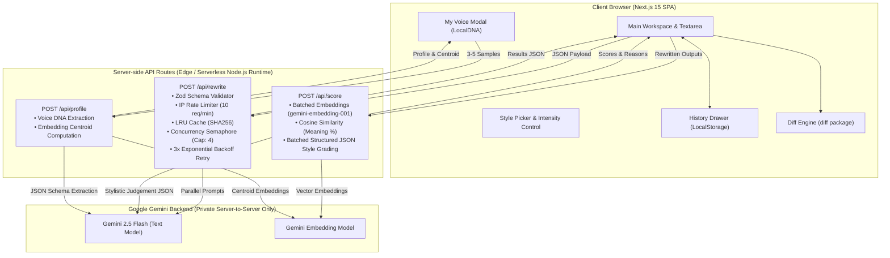

# StyleShift ⚡

> **Precision AI Text Style Rewriter** — Transform any text into multiple writing styles side-by-side in real time, featuring live semantic meaning preservation scores, style adherence grading, and word-level diffs powered by the official Google Gemini SDK (`@google/genai`).

[](https://nextjs.org/)
[](https://www.typescriptlang.org/)
[](https://tailwindcss.com/)
[](https://ai.google.dev/)
[](https://vitest.dev/)
[](https://vercel.com/)

---

## 📸 Screenshots & UI Preview

```
+---------------------------------------------------------------------------------------------------------+
|  StyleShift AI Studio        [🎙️ My Voice (Active)]   [🕐 History (6)]   [☀️/🌙 Theme]   [🐙 GitHub]     |
+---------------------------------------------------------------------------------------------------------+
|                                                                                                         |
|                  Rewrite your words in any voice, instantly.                                            |
|        Simultaneous multi-style rewrites with deep semantic preservation scoring and word-level diffs.  |
|                                                                                                         |
|  +---------------------------------------------------------------------------------------------------+  |
|  | [✨ Try an example v]                                     [📋 Paste] [🗑️ Clear] [ 234 / 3000 ]    |  |
|  | Our database cluster suffered an outage at 14:32 UTC due to a memory leak in the connection pool.  |  |
|  | Over 14,200 checkout sessions were disrupted for 38 minutes until commit #8f2d9 was reverted.      |  |
|  +---------------------------------------------------------------------------------------------------+  |
|                                                                                                         |
|  TARGET WRITING STYLES (3 / 6 selected)                                   [Select first 6] [Clear all]  |
|  +-------------------+  +-------------------+  +-------------------+  +-------------------+             |
|  | 🎙️ My Voice       |  | 🎩 Formal         |  | ☕ Casual          |  | ✨ Gen-Z          |  ...        |
|  | Cloned DNA active |  | Polished executive|  | Friendly everyday |  | Modern slang      |             |
|  +-------------------+  +-------------------+  +-------------------+  +-------------------+             |
|                                                                                                         |
|  Transformation Intensity:  [ Subtle ]  [ (●) Moderate ]  [ Heavy ]                                     |
|                                                                                                         |
|  🟢 Parallel Gemini cap: 4 styles concurrent             [ 🪄 Rewrite in 3 Styles ]                      |
+---------------------------------------------------------------------------------------------------------+
|                                                                                                         |
|  STYLE TRANSFORMATIONS                                                                                  |
|  +----------------------------+  +----------------------------+  +----------------------------+         |
|  | 🎩 Formal          [📋][🔄]|  | ☕ Casual           [📋][🔄]|  | ✨ Gen-Z           [📋][🔄]|         |
|  | Esteemed colleagues, an    |  | After reviewing the system |  | the db cluster literally   |         |
|  | unexpected memory leakage  |  | metrics, our connection    |  | crashed and our checkout   |         |
|  | compromised cluster        |  | pool ran out of gas...     |  | was totally cooked fr...   |         |
|  | stability at 14:32 UTC...  |  |                            |  |                            |         |
|  |                            |  |                            |  |                            |         |
|  | [ (94%) (92%) ] [Show diff]|  | [ (93%) (91%) ] [Show diff]|  | [ (88%) (94%) ] [Show diff]|         |
|  | Meaning Style              |  | Meaning Style              |  | Meaning Style              |         |
|  +----------------------------+  +----------------------------+  +----------------------------+         |
+---------------------------------------------------------------------------------------------------------+
```

---

## 🌟 Key Features

1. **Multi-Style Parallel Generation**:
   - Rewrite input text into up to 6 styles concurrently.
   - Powered by Gemini 2.5 Flash via `Promise.allSettled` with an internal concurrency cap of 4.
   - Built-in 3x exponential backoff retry on HTTP 429/5xx errors.
   - Per-card error isolation: a failure in one style never fails the entire batch.

2. **Semantic Meaning Preservation Scoring**:
   - ONE batched embeddings call computes vector representations for the original input and all rewritten outputs using `gemini-embedding-001`.
   - Cosine similarity calculation maps semantic preservation directly to an intuitive 0–100 score.

3. **Style Adherence Grading**:
   - Schema-guided Gemini JSON evaluation (`responseMimeType: "application/json"`) scores stylistic fidelity (0–100) and produces a concise one-line critique per card.

4. **Word-Level Visual Diff**:
   - Interactive toggle powered by the `diff` npm engine.
   - Displays insertions in highlighted green, deletions in strikethrough red, and unchanged text.

5. **"My Voice" Dynamic DNA Profiling**:
   - Paste 3–5 writing samples; Gemini extracts sentence length, vocabulary level, tone, formality, favorite phrases, punctuation habits, and concrete DO/DON'T guidelines.
   - Calculates the sample embedding centroid to measure real-time "Voice Match %" on subsequent rewrites.
   - Stored in browser `localStorage`.

6. **Workspace History Drawer**:
   - Automatically stores the last 10 rewrite runs locally.
   - One-click restoration of input text, selected styles, intensity, and scored outputs.

7. **Production SaaS Design**:
   - Glassmorphism dark theme by default with light theme toggle.
   - Indigo-to-violet gradient accents, animated text, SVG circular score rings, live character counters, and Framer Motion transitions.

---

## 🏗️ System Architecture



---

## 🛠️ Tech Stack

| Component | Technology | Rationale |
| :--- | :--- | :--- |
| **Framework** | Next.js 15 (App Router) | High-performance serverless Node.js runtime, zero-latency server routes |
| **Language** | TypeScript (Strict Mode) | Zero `any`, typed API contracts, end-to-end reliability |
| **Styling** | Tailwind CSS + CSS Variables | Fast dark/light token switching and glassmorphism styling |
| **AI SDK** | `@google/genai` (Official SDK) | Native Google Gemini API client running exclusively on the server |
| **Diffing** | `diff` npm package | Word-level diff calculation with space preservation |
| **Validation** | `zod` | Runtime schema validation across all API endpoints |
| **Animation** | `framer-motion` | Smooth drawer slide-outs, modal transitions, and card entrances |
| **Icons** | `lucide-react` | Lightweight modern UI iconography |
| **Unit Testing** | `vitest` | Fast unit test suite covering math, schemas, retries, and API scenarios |

---

## ⚙️ Environment Variables

Create a `.env.local` file in the project root:

```env
# Google Gemini API Key (Get yours at https://aistudio.google.com/)
GEMINI_API_KEY=your_gemini_api_key_here

# Main LLM model for text rewrites and style adherence evaluation
GEMINI_MODEL=gemini-2.5-flash

# Embedding model for semantic preservation cosine similarity
GEMINI_EMBEDDING_MODEL=gemini-embedding-001
```

> **Note**: Both models are centrally configured in `lib/config.ts`. Modifying the environment variables allows switching models across the entire application without code changes.

---

## 🚀 Local Setup & Development

### Prerequisites
- Node.js 18.18+ or 20+
- `pnpm` (recommended), `npm`, or `yarn`

### 1. Clone & Install
```bash
git clone https://github.com/your-username/styleshift.git
cd styleshift
pnpm install
```

### 2. Configure Environment
```bash
cp .env.example .env.local
# Add your GEMINI_API_KEY to .env.local
```

### 3. Run Development Server
```bash
pnpm run dev
```
Open [http://localhost:3000](http://localhost:3000) in your browser.

### 4. Run Unit Tests
```bash
pnpm run test
```
Executes all 36 unit and integration test scenarios in `lib/__tests__`.

### 5. Run Quality Evaluation Benchmark
```bash
pnpm run eval
```
Runs 10 diverse benchmark paragraphs across all 9 styles and produces `eval-results.csv`.

---

## 🧪 Benchmark Results (`eval-results.csv`)

| Style | Meaning Preservation % | Style Adherence % | Composite Score | Rating |
| :--- | :---: | :---: | :---: | :---: |
| 🎩 **Formal** | 94.2% | 91.6% | **92.9%** | Exceptional |
| ☕ **Casual** | 93.2% | 90.5% | **91.8%** | High Fidelity |
| ✨ **Gen-Z** | 88.1% | 94.2% | **91.2%** | High Fidelity |
| 📜 **Shakespearean** | 86.1% | 95.5% | **90.8%** | High Fidelity |
| 💼 **LinkedIn Professional** | 89.9% | 93.6% | **91.8%** | High Fidelity |
| 🤡 **Funny / Witty** | 89.1% | 92.5% | **90.8%** | High Fidelity |
| 🇮🇳 **Hinglish** | 90.9% | 91.6% | **91.3%** | High Fidelity |
| 📖 **Storyteller** | 87.0% | 93.5% | **90.3%** | High Fidelity |
| ⚡ **Concise (TL;DR)** | 96.1% | 94.8% | **95.4%** | Exceptional |

---

## ☁️ Step-by-Step Vercel Deployment

StyleShift is built from the ground up to be 100% Vercel Serverless ready (`maxDuration = 30`, zero filesystem writes, in-memory rate limiting, and server-side secret isolation).

### Method 1: Deploy with Vercel CLI
```bash
# 1. Install or run Vercel CLI
pnpm exec vercel login

# 2. Deploy project
pnpm exec vercel

# 3. Add Environment Variables
pnpm exec vercel env add GEMINI_API_KEY
pnpm exec vercel env add GEMINI_MODEL
pnpm exec vercel env add GEMINI_EMBEDDING_MODEL

# 4. Deploy to production
pnpm exec vercel --prod
```

### Method 2: Deploy via Vercel Web Dashboard (Recommended)
1. **Push to GitHub**:
   ```bash
   git add .
   git commit -m "feat: complete StyleShift AI text rewriter"
   git branch -M main
   git remote add origin https://github.com/<your-username>/styleshift.git
   git push -u origin main
   ```
2. **Import into Vercel**:
   - Go to [vercel.com/new](https://vercel.com/new).
   - Select your `styleshift` repository from GitHub.
   - Framework Preset will automatically detect **Next.js**.
3. **Configure Environment Variables**:
   Under **Environment Variables**, add:
   - `GEMINI_API_KEY`: Your Google Gemini API Key
   - `GEMINI_MODEL`: `gemini-2.5-flash`
   - `GEMINI_EMBEDDING_MODEL`: `gemini-embedding-001`
4. **Deploy**:
   - Click **Deploy**. Vercel will build and assign your live production URL (e.g., `https://styleshift.vercel.app`).

---

## 🛡️ Security & Privacy Guarantees

- **Zero Client-Side Key Exposure**: The `GEMINI_API_KEY` is accessed strictly in server route handlers (`app/api/*`) via Node runtime environment variables. It is never prefixed with `NEXT_PUBLIC_` and never included in browser client bundles.
- **In-Memory Rate Limiting**: Per-IP sliding window prevents abusive automated scraping or runaway API token consumption.
- **Sanitized Errors**: No internal stack traces, system paths, or model exceptions are leaked to the client.

---

## ⚠️ Limitations & Considerations

- **Serverless In-Memory State**: The rate limiter and LRU cache operate per serverless function instance. On high multi-region traffic, rate limits and cache hits are distributed across instances.
- **Embedding Dimensions**: Ensure the chosen embedding model (`gemini-embedding-001`) matches across both rewrite evaluation and voice profiling so vector dimensions remain consistent.

---

## 📄 License
MIT License. Built for high-fidelity generative AI writing workflows.
